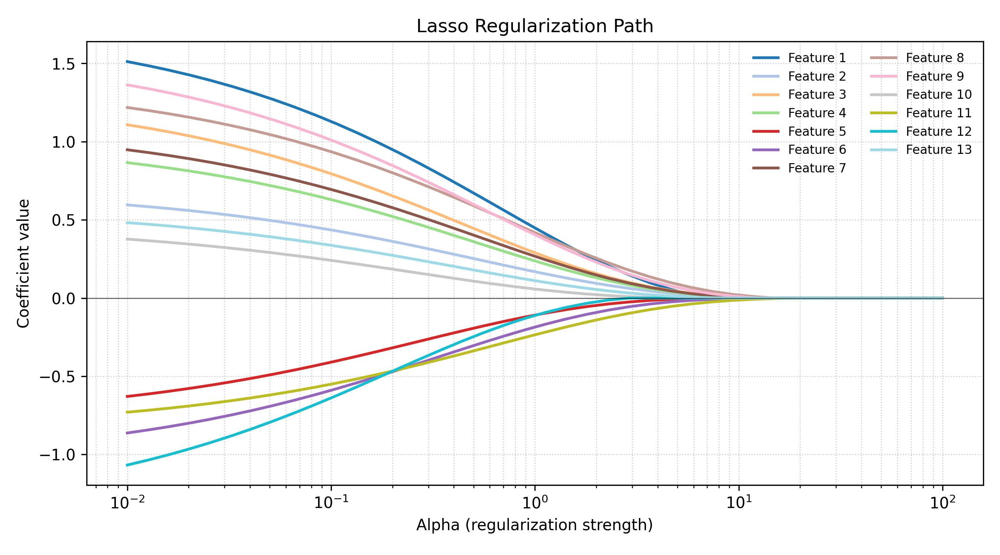

# Regularized Regression from Scratch
Ridge and Lasso regression implemented from scratch in NumPy and evaluated on the California Housing dataset.

## Overview
This repository contains implementations of two regularized linear regression models built without black-box estimators. Ridge regression is solved analytically, while Lasso is solved with coordinate descent and soft-thresholding. The work focuses on how each penalty shapes the fitted coefficients and on the 
sparse solutions produced by the $L_1$ term.

## Models Implemented
- **Ridge Regression:** Closed-form solution for the $L_2$-penalized least squares problem.
- **Lasso Regression:** Coordinate descent with the soft-thresholding operator for the $L_1$-penalized problem.
- **Regularization Path:** A sequence of Lasso fits over a grid of penalty values, used to trace coefficient shrinkage.

## Mathematical Formulation
Both models minimize a penalized least squares objective. Ridge solves:

$$\min_{w} \; \frac{1}{2}\|y - Xw\|_2^2 + \frac{\alpha}{2}\|w\|_2^2$$

which gives the closed-form estimate $w = (X^TX + \alpha I)^{-1}X^Ty$.

Lasso solves:

$$\min_{w} \; \frac{1}{2}\|y - Xw\|_2^2 + \alpha\|w\|_1$$

The penalty term is non-differentiable at zero, so the coefficients are updated one coordinate at a time using the soft-thresholding operator:

$$S_\alpha(\rho) = \mathrm{sign}(\rho)\,\max(|\rho|-\alpha,0)$$

## Requirements
- Python 3.x
- `numpy`
- `matplotlib`
- `scikit-learn`

## Usage
Run the demo script:
python regularized_regression.py

## Outputs
Console report with the Ridge and Lasso coefficients for a fixed penalty value.
A Lasso regularization path saved as lasso_path.png.
Printed values of the training and test error for each model.

## Project Structure
regularized-regression-from-scratch/

─ regularized_regression.py          # Main implementation and demo

─ lasso_path.png                     

                                     # Regularization path plot
                              
─ README.md                          # Documentation

## Notes
The features are standardized before fitting, since regularized models are not scale-invariant, and the intercept is kept out of the penalty term. Only a subset of the California Housing data is used so the coordinate descent loop finishes quickly. The resulting coefficients depend on the chosen tolerance, the 
iteration limit, and the range of penalty values.

